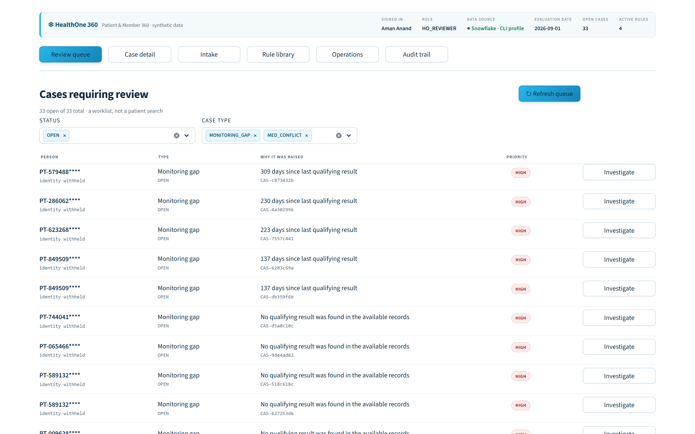
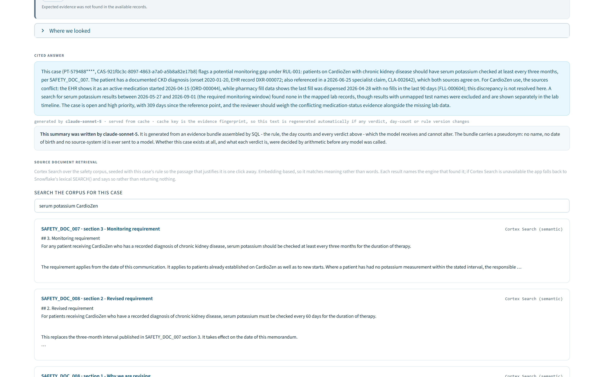
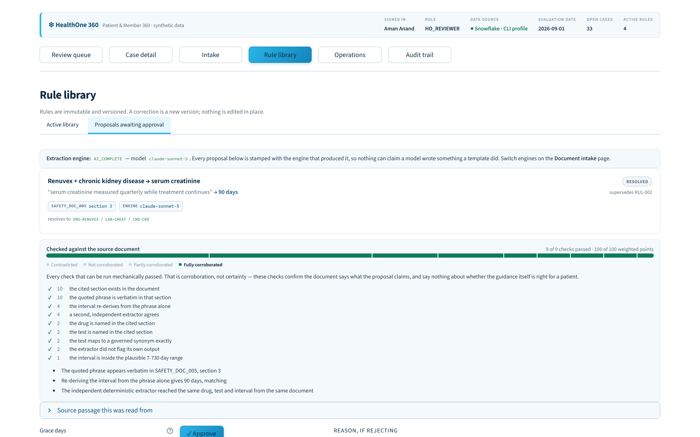
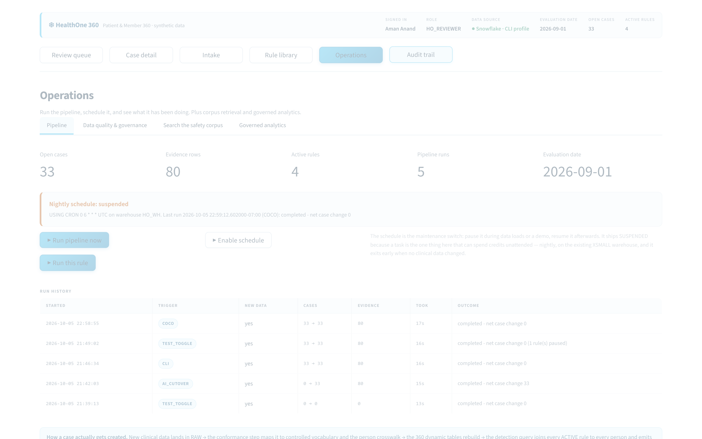

# HealthOne 360 — Patient Safety Case Investigator

**Snowflake CoCo CLI Hackathon 2026 · GCC Edition**
Patient & Member 360 + Clinical/Regulatory Document Copilot

Safety guidance is already written down. This is the missing pipeline that
carries it from a document to the specific patients whose data violates it —
with a human in control at both ends, and every step attributable.

Everything is synthetic. The drugs (CardioZen, Renuvex, Hepatrol) are
invented, so no real medical guidance is misquoted.

---

## Look at the running app

It is deployed as Streamlit **in** Snowflake, in the account it was built in.

| | |
|---|---|
| **App** | https://app.snowflake.com/streamlit/HHUAQYZ/OP69802/#/apps/pzki3x4k6paxuqalo7j4 |
| **Login** | `JUDGE_HO360` / `CocoCli2026` |
| **Sees** | The app as a Clinical Case Reviewer: `HO_REVIEWER`, read-only, patient identity masked by policy |

Streamlit in Snowflake has no anonymous mode, so a login is unavoidable — that
account is a disposable hackathon trial holding nothing but synthetic data.

Prefer to run it yourself with no account at all? → [Run it](#run-it), fixture
mode, two commands.

---

## What it looks like

| | |
|---|---|
|  | **The queue.** Prioritised review cases. Priority decomposes into visible rule factors — there is no opaque score anywhere in this product. Patient identity is a hash-derived pseudonym, not a masked medical record number. |
|  | **Evidence, reconciled across four source systems.** AGREES, CONFLICTS and MISSING, each with the record ids behind it. On a CONFLICT the system shows both sides and refuses to choose. |
|  | **The approval gate.** Nine deterministic checks against the source document, each weighted, before a human ever sees the draft. The two anti-fabrication gates carry the heaviest weight. This is corroboration, not confidence. |
|  | **Hash-chained audit.** Every approval, rejection, disposition and identity reveal. Verified by attacking it: a tampered row breaks the chain and the integrity view says where. |

---

## The ten-second version

A regulator or a hospital safety committee publishes new guidance. It arrives
as a document — a sentence in a PDF. That is all it is: information. Nothing
changes until a human reads it, works out what it means, and goes looking for
the patients it affects. That gap is where people get missed.

This closes the gap, without letting a language model decide who is at risk.

---

## The problem, concretely

Some medicines require a blood test on a schedule. A safety committee writes it
down — *"patients on CardioZen who have chronic kidney disease must have serum
potassium checked at least every three months."* The knowledge exists on day
one. It reaches the patients months later, if ever. Three reasons:

1. **The knowledge is prose.** "Every three months", "quarterly", "at 12-week
   intervals" — no system can act on a sentence.
2. **The proof is scattered.** Proving one patient complies means joining the
   hospital record (is the drug prescribed?), the pharmacy (is it being
   collected?), claims (is the condition confirmed?) and the lab (was the test
   done, and when?) — four systems that disagree and identify people
   differently.
3. **Investigation is manual.** 30–60 minutes of clicking between systems, with
   no record of what was checked.

**The user of this product is a Clinical Case Reviewer. Never the patient.**

## What it does

```
safety document → AI-proposed rule → nine deterministic checks → human approves
   → versioned rule → deterministic evaluation over a Patient & Member 360
   → prioritised review cases → evidence reconciled with citations
   → reviewer disposition → immutable audit
```

The governing principle, and the thing to protect in every design choice:

> **AI proposes → human approves → deterministic checks apply → human decides.**

Language understanding is the model's job. Deciding whether a case exists is
arithmetic's job. If you ask *"where could the AI hallucinate a patient into
your queue?"*, the answer is **nowhere** — it has no code path that creates a
case.

---

## CoCo CLI

This was built, deployed, tested and demonstrated from CoCo CLI
(`cortex`) against one Snowflake account. Not a worksheet, not by hand.

### A custom skill ships in this repository

[`.cortex/skills/patient-evidence-review/SKILL.md`](.cortex/skills/patient-evidence-review/SKILL.md)
teaches CoCo how to investigate a case: which tables hold the rule, the
evidence and the citations, and one hard instruction — **it must never resolve
a CONFLICT on a reviewer's behalf.** When two source systems disagree, the
skill reports the disagreement and recommends who to ask. That constraint is a
file in version control, not a prompt someone typed.

```bash
cortex skill add .cortex/skills/patient-evidence-review
cortex skill list
```

### The three things CoCo drives

```bash
# 1. INPUT — documents in, proposals out. Parse, chunk, extract. Stops at PROPOSED.
cortex exec -c <conn> --allowed "sql" --max-turns 10 \
  "Call HEALTHONE.RULES.SP_INGEST_EXTRACT_ALL('<actor>', TRUE) and report the
   backend, the document count and the chunk count."

# 2. OUTPUT — rules in force become cases, with evidence reconciled.
cortex exec -c <conn> --allowed "sql" --max-turns 8 \
  "Call HEALTHONE.CASES.SP_RUN_PIPELINE('DEMO', TRUE, '<actor>') and report
   open_after and evidence_rows."

# 3. INVESTIGATION — the skill works a live case end to end.
cortex exec -c <conn> --allowed "sql" --max-turns 12 \
  "Use the patient-evidence-review skill. Take the highest-priority OPEN case
   and explain in under 120 words why it exists: the rule, the model that
   extracted it, the document phrase quoted verbatim, and each evidence verdict
   with its record ids."
```

Two things that cost failed runs to discover, so they are written down:
`--allowed "sql"` is required in `exec` mode (`exec` auto-rejects approvals, so
the SQL tool is blocked unless you name it), and `SNOWFLAKE_HOME` must be
exported before launching `cortex` — it reads `~/.snowflake/connections.toml`
by default.

### Session evidence, in the repository

[`coco/`](coco/) holds the raw output of real CoCo sessions, dated, one folder
per phase. Nothing in there was written by hand after the fact.

| Folder | What is in it |
|---|---|
| [`coco/planning/`](coco/planning/) | CoCo reviewing our data model as an independent architect, **plus our written rebuttal** of the half it got wrong |
| [`coco/development/`](coco/development/) | The full ingest-and-detect pipeline driven by CoCo |
| [`coco/validation/`](coco/validation/) | The skill investigating a case, returning a cited answer with real record ids |

The planning artefact is the one worth reading. We asked CoCo to criticise the
design and kept the answer. It found something we had not documented: the
fixed-date join that makes our tests reproducible also forecloses incremental
refresh on the dynamic tables, whatever the scheduler is set to. Its second
criticism was wrong, and `coco/planning/` records the rebuttal with the query
output that settles it — because a review where only the flattering half is
kept is not a review.

[`AGENTS.md`](AGENTS.md) is the repo's instruction file for CoCo and other
agents: the constraints that must not be relitigated, and where each design
answer lives.

---

## What works, stated plainly

Verified against the live account on 2026-10-06, not asserted from memory.

| Capability | Status |
|---|---|
| Layered data model (RAW → CONF → P360 → RULES/CASES) | **Working** — 47 tables, 312 people |
| Document intake: `AI_PARSE_DOCUMENT` from an internal stage | **Working** — 7 PDFs → 43 chunks |
| **AI rule extraction** — `AI_COMPLETE`, `claude-sonnet-5` | **Working** — 9 proposals |
| Nine deterministic corroboration checks on every proposal | **Working** |
| Human approval gate | **Working** — all 4 active rules carry a named approver |
| Deterministic case detection (dynamic table) | **Working** — 33 open cases |
| Evidence reconciliation with citations | **Working** — 80 evidence rows, 3 verdicts |
| Cortex Search over the document corpus | **Working** — 1 service |
| Governed semantic view | **Working** |
| PHI protection (pseudonyms, policy masking, break-glass) | **Working and verified by attacking it** |
| Tamper-evident audit trail | **Working and verified by attacking it** |
| Streamlit in Snowflake | **Deployed** |
| Self-running pipeline (task + stream) | Working; left suspended to protect trial credits |

**Every active rule was extracted by a model and approved by a human.** None
were hand-written: `MODEL_NAME = claude-sonnet-5` on all four, each joined to
the document chunk it came from and the phrase it quoted. You can check that claim in one query:

```sql
SELECT r.RULE_ID, r.INTERVAL_DAYS, r.INTERVAL_SOURCE_PHRASE, r.DOC_ID,
       r.APPROVED_BY, p.MODEL_NAME
  FROM HEALTHONE.RULES.SAFETY_RULE r
  LEFT JOIN HEALTHONE.RULES.RULE_PROPOSAL p
         ON p.PROPOSAL_ID = r.SOURCE_PROPOSAL_ID
 WHERE r.STATUS = 'ACTIVE' ORDER BY r.RULE_ID;
```

### And what is deliberately not real

An honest list is more useful than a long one:

- **All data is synthetic**, generated by `tools/generate_data.py`. The drug
  names are invented on purpose.
- **"Today" is frozen.** `as_of` comes from `CONF.DATE_ANCHOR` — one row, fixed
  at 2026-09-01 — never `CURRENT_DATE`. That keeps dynamic tables
  deterministic and stops the demo rotting as dates drift. It is also the thing
  CoCo correctly identified as blocking incremental refresh.
- **Dynamic tables run with `SCHEDULER = DISABLE`** and are refreshed by an
  explicit button. A 60-second lag would wake the warehouse every minute and
  drain a trial account.
- **Four rules is a demonstration, not a library.** The extraction path is
  general; the corpus is seven documents.
- **No real source-system integration.** RAW is loaded from CSV, in the shape
  four real systems would deliver.

Full version: [`docs/WALKTHROUGH_what_is_real.md`](docs/WALKTHROUGH_what_is_real.md).

---

## Run it

### Without Snowflake (2 minutes)

```bash
pip install streamlit
streamlit run app/streamlit_app.py
```

Runs against `fixtures/answer_contract.json`. No credentials, nothing to break.
The fixture contains **no PHI** — by design, so fixture mode cannot leak what
live mode protects.

### Set up the CLI

```bash
pip install snowflake-cli
# put a profile in ~/.snowflake-ho360/connections.toml - see INSTALLATION.md
export SNOWFLAKE_HOME="$HOME/.snowflake-ho360"
HO_PROFILE=hackathon tools/sfx connection test
```

`tools/sfx` is the only sanctioned way to invoke the CLI here, and the reason
is not style. It pins `SNOWFLAKE_HOME` to a project-only directory, so this
project physically cannot read or modify a credential that may already exist in
the CLI's default `~/.snowflake/`. It has **no default profile** and exits
non-zero if `HO_PROFILE` is unset — an earlier version defaulted to a profile
and silently deployed to a dead account for a while. `HO_PROFILE` also lets you
run the same command as `HO_REVIEWER` to see exactly what a reviewer sees.

### Build the whole thing from scratch

Two commands. The first is the only one that needs ACCOUNTADMIN.

```bash
HO_PROFILE=hackathon tools/sfx sql -f sql/26_new_account_setup.sql
HO_SF=./tools/sfx HO_PROFILE=hackathon tools/deploy_new_account
```

That creates the database, 47 tables, 5 dynamic tables, the policies, tags,
metrics, UDFs and procedures; loads 312 synthetic people and 7 safety
documents; enables Cortex; runs document intake and AI extraction; deploys the
Streamlit app; applies the cost controls; and finishes by running the test
suites and printing a pass/fail line per suite.

It is ordered by dependency and every step is idempotent, so re-running it is
safe. Add `HO_NO_CORTEX=1` on an account where Cortex is not entitled — the
extraction engine then stays on its deterministic backend and the app reports
that, rather than failing. That mode exists because three trial accounts
refused Cortex before one was entitled; it is the reason this repo survived
losing an account twice.

### The pipeline, step by step

Each is a single CLI call, and each is what the corresponding tab in the app
triggers. Run them through `cortex exec` (above) or `tools/sfx`:

```bash
# documents in -> proposals out (parse, chunk, extract; stops at PROPOSED)
tools/sfx sql -q "CALL HEALTHONE.RULES.SP_INGEST_EXTRACT_ALL('<actor>', TRUE)"

# what came out, and whether it can become a rule
tools/sfx sql -q "SELECT DOC_ID, DRUG_TEXT, REQUIRED_TEST_TEXT, INTERVAL_DAYS,
                         RESOLVE_STATUS FROM HEALTHONE.RULES.V_PROPOSAL_RESOLVED
                   WHERE STATUS='PROPOSED'"

# the nine deterministic checks against the source document
tools/sfx sql -q "SELECT DOC_ID, CORROBORATION_SCORE, CHECKLIST
                    FROM HEALTHONE.RULES.CORROBORATION_SNAPSHOT"

# a human approves one (this is the gate; nothing else writes a rule)
tools/sfx sql -q "CALL HEALTHONE.RULES.SP_APPROVE_PROPOSAL('<proposal_id>','<actor>',7)"

# rules in force -> cases out, with evidence reconciled
tools/sfx sql -q "CALL HEALTHONE.CASES.SP_RUN_PIPELINE('CLI', TRUE, '<actor>')"

# pause a rule without touching the cases it already raised
tools/sfx sql -q "CALL HEALTHONE.RULES.SP_SET_RULE_ENABLED('RUL-001', FALSE, '<actor>', 'escalated')"
```

### Deploy the app into Snowflake

```bash
cd app && HO_PROFILE=hackathon ../tools/sfx streamlit deploy --replace --role HO_ADMIN
```

### Run the tests

```bash
for t in assertions test_detection_golden test_document_intake \
         test_rule_toggle test_corroboration; do
  HO_PROFILE=hackathon tools/sfx sql -f "tests/$t.sql"
done
python tests/smoke_app.py
```

---

## How a case comes into existence

No human and no model decides that a case exists.

```
new clinical data lands in RAW
  ↓  conformance: vocabulary mapping + identity crosswalk
CONF
  ↓  the 360 rebuilds (dynamic tables)
P360
  ↓  detection joins every ACTIVE rule to every person
DT_CASE_CANDIDATE
  ↓  MERGE — never touches a reviewer's decision
CASE_REGISTRY
  ↓  reconciler
CASE_EVIDENCE  (AGREES / CONFLICTS / MISSING, each with citations)
```

**Proven, not asserted:** a brand-new patient was inserted straight into `RAW`
with nothing told about them. One pipeline call later the case count had risen
by exactly one, the evidence count by three, and that person had a
`MONITORING_GAP` case with three evidence claims and citations.

### The detection logic

Rule `RUL-001`: *CardioZen + chronic kidney disease → serum potassium, every
90 days, 7 days grace.*

```
window_start = LATEST OF (therapy start, condition onset, as_of − 97 days)
a case exists  ⟺  the newest qualifying result is before window_start
```

Each anchor prevents a specific bug: a test predating the drug can't count as
monitoring for it; nor can one predating the condition; and the grace window
stops a patient flickering in and out of the queue at exactly day 90.

**Interval arithmetic is literal, and this is not pedantry.** The live rules
run at 90, 84 and 42 days. `RUL-003` is 84 because its document says "measured
at twelve-week intervals" — twelve weeks is 84 days, not 90. `RUL-004` is 42
for "six weeks", not 45. A system that rounded weeks to months would be wrong
by days of unmonitored patient, in the direction that hurts.

### Evidence, and refusing to adjudicate

The reconciler returns three verdicts per claim, each with the record ids
behind it:

- **AGREES** — the hospital record and the insurance claim both confirm the
  condition.
- **CONFLICTS** — the hospital says the drug is active; the pharmacy says
  nothing has been collected in 90 days. **The system shows both and refuses to
  choose.** If this patient stopped taking the drug, the rule may not apply at
  all — that is a clinician's judgement, not a model's.
- **MISSING** — stated as a finding, in a fixed form: *"No <test> result was
  found in the available records between <start> and <end>."* Never a blank
  cell, because a blank cell is indistinguishable from a bug.

---

## Patient identity

A reviewer does not need to know who the patient is to judge whether a test is
overdue. So identity is **absent by default**:

- The queue shows a pseudonym (`PT-849509••••`), derived from a hash — never
  from the real medical record number, since real MRN digits are themselves
  partial PHI.
- **The app does not query name, DOB or source ids at all.** Minimum-necessary
  applied to the SQL, not just to the rendering.
- Masking is enforced by **policy**, so a SQL client bypassing the app gets the
  same protection.
- **No role is exempt** — including `HO_ADMIN`. Reading a name means breaking
  glass, which is reason-coded, 30-minute-limited, and logged by the same
  stored procedure that grants it. "Revealed but not logged" is unreachable.

Verified as `HO_ADMIN` with no grant: `NAME → ••• NAME WITHHELD •••`,
`DOB → 1900-01-01`, `PATIENT_ID → P••••`. After breaking glass the named
patient resolves while every other patient stays masked.

---

## Tests

Six suites, run against the live account. **162 checks, zero failures.**

| Suite | Checks | What it proves |
|---|---|---|
| `tests/assertions.sql` | 47 | Keys unique, no orphans, enums valid, PHI actually masked (A-15), audit untampered (A-17) |
| `tests/test_detection_golden.sql` | 16 | Eight patients pinned to eight edge cases |
| `tests/test_document_intake.sql` | 17 | Stage → parse → chunk → proposal, including the load-history trail |
| `tests/test_rule_toggle.sql` | 17 | Pausing a rule cannot alter a case already raised |
| `tests/test_corroboration.sql` | 29 | Each of the nine checks fires on a planted violation, and the weights add up |
| `tests/smoke_app.py` | 36 | Every read the app performs, plus the corroboration meter's colour rules |

The three **negative** golden assertions matter most — a patient at 93 days
(inside the grace window), a compliant patient, and one on the drug without the
condition must all produce **no case**. That is detection precision, and it is
what stops the queue crying wolf.

The corroboration suite is the one that caught a real defect. A proposal whose
quoted phrase did **not** appear verbatim in the source document still scored
85%, because the two anti-fabrication gates were weighted the same as cosmetic
checks. They are now weighted 10 each. The test was right about the weighting,
not about the threshold.

Detection was also independently reimplemented in Python and run over the CSVs
before deployment. It predicted a specific case count and distribution; the SQL
produced exactly that. Two independent implementations agreeing is stronger
evidence than one implementation passing its own test.

---

## Snowflake features used, and why each earns its place

| Feature | Problem it solves |
|---|---|
| `AI_PARSE_DOCUMENT` (LAYOUT) | Reads a PDF into text and sections, so citations can point at a section |
| `AI_COMPLETE` (`claude-sonnet-5`) | Turns a prose sentence into a structured rule proposal that quotes its source |
| Cortex Search | Semantic retrieval over the corpus with section-level citations |
| Dynamic tables | Detection recomputes when rules or data change, with no orchestration code |
| `SCHEDULER = DISABLE` + manual refresh | A 60-second lag would wake the warehouse every minute and drain the trial |
| Tasks + streams (`SYSTEM$STREAM_HAS_DATA`) | Nightly self-running pipeline that exits early when nothing changed |
| Internal stage + directory table | Documents arrive as files, with load history as the audit of what was read |
| Masking policies (conditional) | PHI protection scoped per patient, so one reveal ≠ cohort exposure |
| Object tags + tag-based masking | Answers "where is the patient data, and is it protected?" in one query |
| Row access policy | Reviewers scoped to their assigned clinics |
| Data metric functions | Data quality as a monitored property, not a periodic check |
| Semantic view | Governed aggregate questions with no per-question SQL and no text-to-SQL |
| Python + SQL UDFs | Interval parsing and corroboration scoring, callable from SQL and testable |
| Stored procedures (owner's rights) | Break-glass that cannot be performed without logging |
| Resource monitors (warehouse + account) | Hard ceilings; the account monitor is the only one that sees serverless spend |
| `AUTO_SUSPEND = 180` | Measured, not guessed: 20.9s cold vs 0.9s warm, ~0.05 credits per idle-out |
| Streamlit in Snowflake | The UI runs in-account, so "no data leaves" is true of the UI too |

Consciously skipped: the Cortex Agents API (needs container runtime, and
Streamlit in Snowflake runs on warehouse), MCP, and multi-agent orchestration.
None solves a problem this product has.

**Cost:** 3.9 credits used of a 120-credit account cap, with every warehouse
X-Small and auto-suspending. `sql/30_cost_controls.sql` is idempotent and can
shut the whole account down at any time.

---

## Documentation map

| Question | File |
|---|---|
| What each tab does, and what is simplified | [`docs/APP_GUIDE.md`](docs/APP_GUIDE.md) |
| What is real and what is fabricated | [`docs/WALKTHROUGH_what_is_real.md`](docs/WALKTHROUGH_what_is_real.md) |
| Tab-by-tab walkthrough | [`docs/WALKTHROUGH_tab_by_tab.md`](docs/WALKTHROUGH_tab_by_tab.md) |
| Pipeline and tables, end to end | [`docs/WALKTHROUGH_pipeline.md`](docs/WALKTHROUGH_pipeline.md) |
| Why the product exists; why each big choice | [`docs/01_PROBLEM_AND_WHY.md`](docs/01_PROBLEM_AND_WHY.md) |
| Architecture, component by component | [`docs/02_ARCHITECTURE.md`](docs/02_ARCHITECTURE.md) |
| Every table, column, key; detection & reconciler logic | [`docs/03_DATA_MODEL.md`](docs/03_DATA_MODEL.md) |
| Synthetic data spec + the 8 golden patients | [`docs/04_SYNTHETIC_DATA_SPEC.md`](docs/04_SYNTHETIC_DATA_SPEC.md) |
| Streamlit pages and states | [`docs/05_UI_SPEC.md`](docs/05_UI_SPEC.md) |
| How everything is tested; what green means | [`docs/06_TESTING.md`](docs/06_TESTING.md) |
| Settled decisions (do not relitigate) | [`docs/DECISIONS.md`](docs/DECISIONS.md) |
| What exactly we are building | [`docs/PRODUCT_STORY.md`](docs/PRODUCT_STORY.md) |
| Zero to a running app | [`INSTALLATION.md`](INSTALLATION.md) |
| Instructions for CoCo and other agents | [`AGENTS.md`](AGENTS.md) |

---

## Licence

MIT — see [LICENSE](LICENSE). The synthetic data and the invented drug names
are covered by it too; none of it is medical guidance and none of it should be
used as any.
